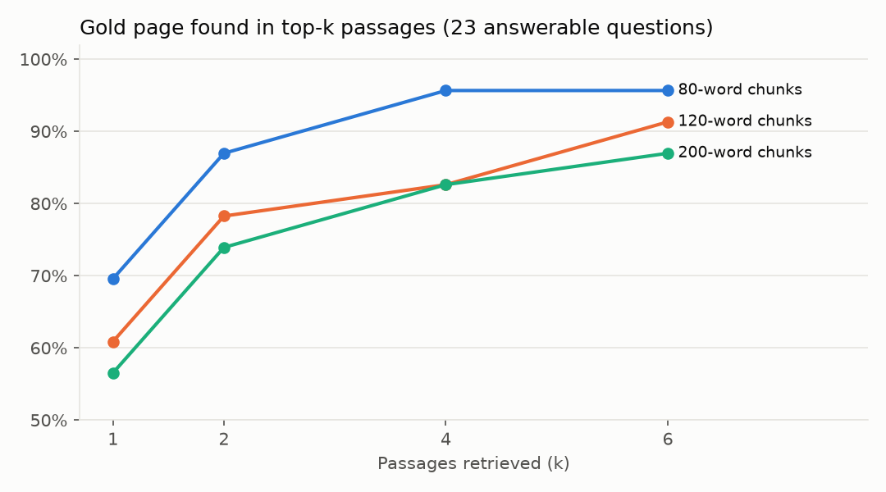
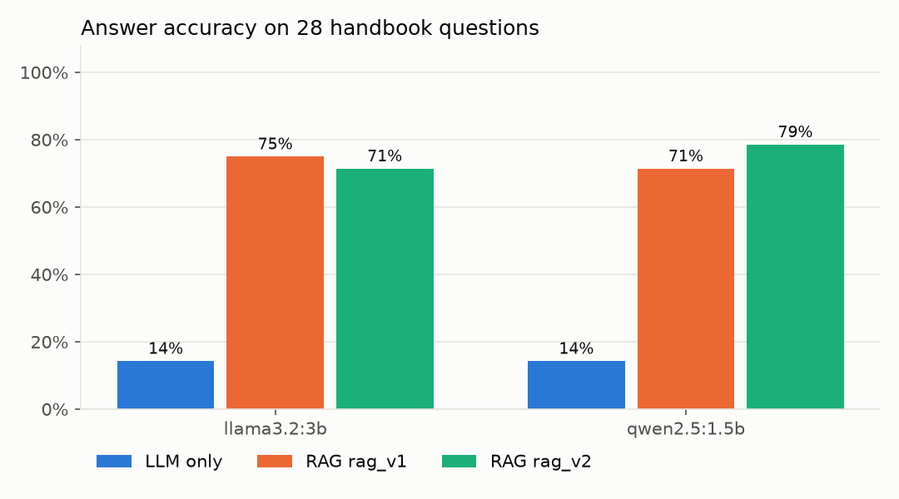
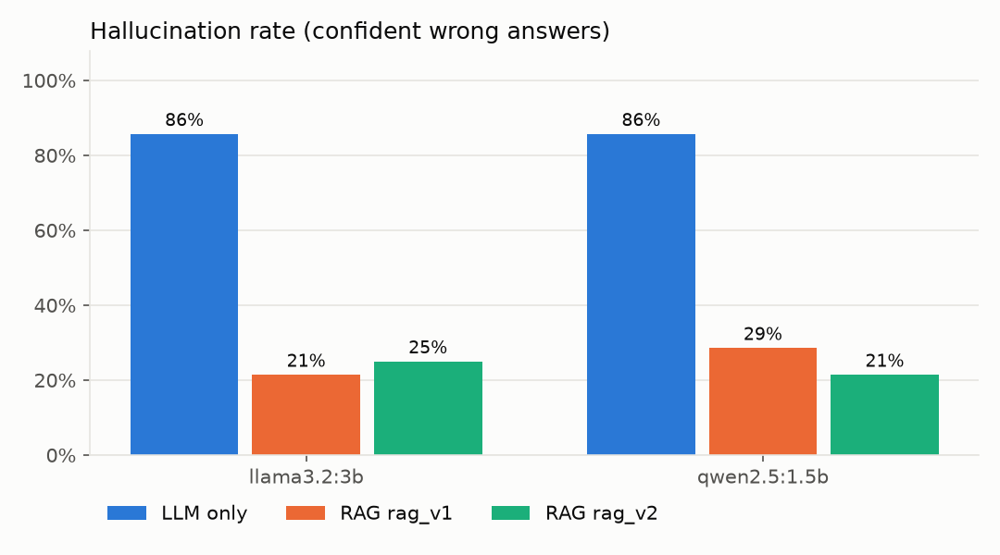
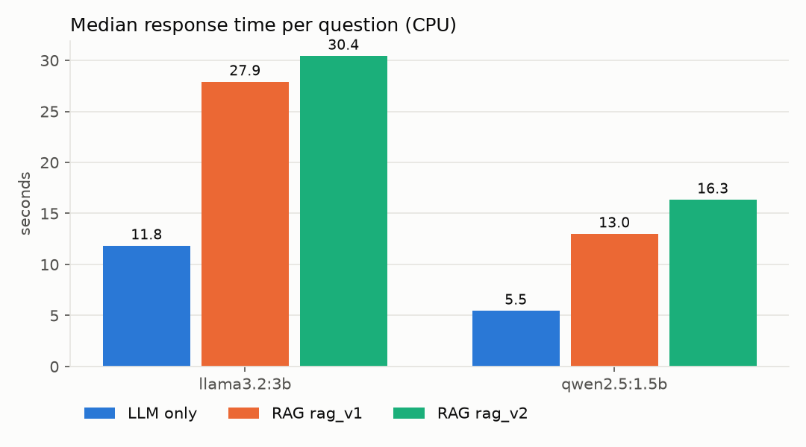
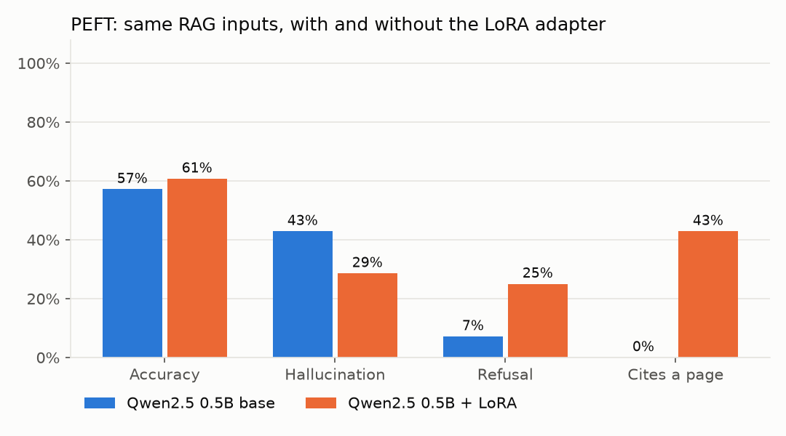

# Student Support Chatbot: LLM vs RAG vs LLMOps (plus a small PEFT test)

LCA activity: experimental and problem-based learning (LLM / RAG / LLMOps)

The idea was to build a chatbot that answers student questions from the CHRIST University handbook
for 2026-27 (109 pages), and along the way actually run the three models we were asked to explore
instead of just reading about them. Everything ran on my laptop: an i5-1235U with 16 GB RAM and
integrated Intel graphics, so no GPU. All models ran on the CPU through Ollama or Hugging Face, and I
didn't use any paid APIs.

A quick note on the numbers: everything in the tables was measured by the scripts in this repo, and
the raw answers for every question are in `experiments/results/`. Where I'm explaining *why*
something happened from theory rather than from a measurement, I've said so.

## 1. What the three models are

**LLM.** A large language model is a transformer that predicts the next token based on what it saw
during training. I used two small open models through Ollama, both 4-bit quantised so they fit in
RAM:

| | qwen2.5:1.5b | llama3.2:3b | Qwen2.5-0.5B (used for PEFT) |
|---|---|---|---|
| Parameters | 1.5 B | 3.2 B | 0.49 B |
| Layers | 28 | 28 | 24 |
| Hidden size | 1536 | 3072 | 896 |
| Attention heads / KV heads | 12 / 2 | 24 / 8 | 14 / 2 |
| Context window | 32K | 128K | 32K |
| Size on disk | 940 MB | 1,926 MB | 942 MB |

Roughly how it works:
* The text is split into tokens and each token becomes a vector.
* Each layer runs self-attention (softmax(QK^T / sqrt(d)) V), so each token can look at the ones
  before it.
* At the end there's a probability for every word in the vocabulary. With temperature 0 it just takes
  the most likely one, then repeats.
* Both models use grouped-query attention (fewer KV heads), which saves memory. That matters a lot
  on a CPU.

**RAG.** Retrieval-Augmented Generation means you don't rely on what the model memorised. You search
your own documents first and paste the relevant bits into the prompt. My pipeline:

```
handbook PDF -> text per page -> remove headers/page numbers -> 80-word chunks (20 overlap)
             -> MiniLM embeddings (384 numbers per chunk) -> ChromaDB

question -> embed it the same way -> 4 closest chunks (with page numbers)
         -> prompt with rules + chunks + question -> LLM -> answer with (p. N)
```

**LLMOps.** These are the boring-but-important bits that make an LLM project repeatable:
* tracking experiments
* versioning prompts and data
* logging what the bot does
* measuring whether a change actually helped

I used MLflow for tracking, YAML files for prompts, and a JSONL log for the chatbot.

**PEFT.** I added this later. Parameter-efficient fine-tuning, specifically LoRA, freezes the whole
model and trains a tiny add-on instead: W' = W + (alpha/r)·B·A, where A and B are thin matrices. With
rank 8 on two attention layers, only about 0.1% of the weights train.

## 2. How I tested everything

I wrote 28 questions by hand from the handbook and noted the correct answer and page for each one
(`experiments/questions.yaml`). I deliberately mixed the types:

* 15 straightforward factual ones ("What is the fine for returning a library book late?")
* 3 that need two sections combined ("My attendance is 82%. Can I write the ESE, and am I eligible for
  the merit scholarship?")
* 3 vaguely worded ones ("whats the pass mark")
* 4 the handbook can't answer ("What is the campus Wi-Fi password?")
* 3 trick questions with a wrong assumption ("How is the Rs. 50 per day late fine collected?" when
  it's actually Rs. 5)

Scoring is rule-based so every run is judged the same way:
* An answer counts as correct if it has all the required facts. Numbers have to match exactly, so 50
  doesn't count as 5, and the answer can't contain anything that contradicts the right answer.
* For questions the handbook can't answer, the only correct response is to say so.
* A confident wrong answer counts as a hallucination.

All runs used temperature 0 and a fixed seed. I recorded time per answer, tokens per second, peak RAM
and CPU use. I also unloaded each model before loading the next one, so the memory numbers didn't
overlap.

## 3. Model 1: just the LLM

First I gave both models some general tasks: summarise a paragraph, explain CIA to a first-year,
rewrite a rude email politely, classify a query, and do a percentage calculation. Both handled all of
these fine.

| | qwen2.5:1.5b | llama3.2:3b |
|---|---|---|
| Average time per answer | 10.0 s | 17.2 s |
| Speed | 8.1 tokens/s | 5.7 tokens/s |
| Time to load into RAM | 11.2 s | 14.2 s |
| RAM used | 1.2 GB | 2.5 GB |
| CPU | ~100% | ~100% |

Then I asked the 28 handbook questions without giving them the handbook:

| | qwen2.5:1.5b | llama3.2:3b |
|---|---|---|
| Accuracy | 14.3% | 14.3% |
| Hallucination rate | 85.7% | 85.7% |
| Said "I don't know" | 7.1% | 3.6% |

This was the most eye-opening part. Both models answered almost everything confidently and almost
everything was wrong:
* "The minimum attendance required ... is typically 75%." The handbook says 85%.
* "An undergraduate student can borrow up to 10 books ... for 3 weeks." It's 2 books for 14 days.
* "The hostel fee per year is ₹12,000." This isn't in the handbook at all.
* Both thought "ESE" meant the Engineering Services Examination.

The bigger model didn't do any better, which makes sense: neither model has ever seen this handbook.
It's a knowledge problem, not a model-size problem. The handful they got right were things like
"international students need a passport and visa", which is general knowledge.

## 4. Model 2: RAG

### Picking the chunk size

Before involving the LLM at all, I checked whether retrieval finds the right page. I tried three chunk
sizes and different numbers of retrieved chunks (k), on the 23 questions that have an answer:

| Chunk size | Chunks | Top 1 | Top 2 | Top 4 | Top 6 |
|---|---|---|---|---|---|
| 80 words | 552 | 69.6% | 87.0% | 95.7% | 95.7% |
| 120 words | 372 | 60.9% | 78.3% | 82.6% | 91.3% |
| 200 words | 228 | 56.5% | 73.9% | 82.6% | 87.0% |



Smaller chunks clearly worked better. My guess at why: MiniLM only reads about 256 word-pieces, so
bigger chunks get cut off. A big chunk also covers several topics, so its embedding ends up vague. I
went with 80 words and top 4. The only question it still missed was "whats the pass mark", which is
just too vague to point to one page. A search takes about 0.05 s, so retrieval is basically free
compared to the LLM.

### Full RAG

I ran both models with two prompt versions:
* **v1** is a basic "answer only from the context, cite the page, say you can't find it otherwise".
* **v2** adds steps for checking whether the question has a wrong number in it, plus two made-up
  examples. I made sure the examples didn't contain any real handbook facts, so they couldn't leak
  answers.

| | qwen v1 | qwen v2 | llama v1 | llama v2 |
|---|---|---|---|---|
| Accuracy | 71.4% | 78.6% | 75.0% | 71.4% |
| Hallucination rate | 28.6% | 21.4% | 21.4% | 25.0% |
| Right page retrieved | 95.7% | 95.7% | 95.7% | 95.7% |
| Numbers that came from the context | 79.5% | 86.2% | 76.1% | 87.5% |
| Median time | 13.0 s | 16.3 s | 27.9 s | 30.4 s |
| Slowest 5% | 21.2 s | 23.9 s | 34.0 s | 39.6 s |
| Peak RAM | 1.6 GB | 1.4 GB | 3.0 GB | 3.1 GB |

By question type:

| | No handbook | qwen v1 | qwen v2 | llama v1 | llama v2 |
|---|---|---|---|---|---|
| Factual (15) | 13% | 87% | 93% | 80% | 80% |
| Two sections (3) | 0% | 0% | 33% | 33% | 33% |
| Vague (3) | 0-33% | 100% | 100% | 67% | 67% |
| Not in handbook (4) | 25% | 75% | 50% | 100% | 100% |
| Trick questions (3) | 0-33% | 33% | 67% | 67% | 33% |





What I took from this:
* **RAG made the biggest difference in the whole project.** Same models, same questions: accuracy
  went from 14% to 71-79% and hallucination dropped from 86% to 21-29%. The answers also cite pages
  now, e.g. "An undergraduate can borrow 2 books. (p. 21)".
* **A better prompt for one model isn't necessarily better for another.**
  * v2 helped qwen catch the trick questions ("The handbook says Rs.5/- per day, not Rs.50/- per
    day").
  * But qwen then started using that "The handbook says..." pattern on questions it should have
    refused, so its refusals dropped from 75% to 50%.
  * v2 made llama slightly worse overall.
  * I wouldn't have noticed any of this without running both versions on the same questions.
* **The most common mistake left is mixing up two similar rules.** The handbook has a 75% per-course
  attendance rule for the mid-semester exam and an 85% overall rule for the end-semester exam (p. 56
  and p. 93). When both show up in the retrieved text, the small models sometimes pick the wrong one,
  e.g. "you are eligible ... as it exceeds the 75% threshold". Retrieval found the right page here; the
  model just misread it.
* **Questions needing two sections were the hardest** (0-33%). That's more of a reasoning problem than
  a retrieval one, and 1.5-3B models are not great at it.
* qwen with v2 was the most accurate setup, and it used about half the time and RAM of llama.

## 5. PEFT: with and without LoRA

This was meant as a small demo, not a full fine-tuning project.

**Training data.** I generated 59 short training examples in the same format the chatbot uses:
* 40 question-answer pairs written by qwen2.5:1.5b from handbook passages. I only kept a pair if every
  number in the answer actually appears in the passage.
* 19 "I could not find this" examples, made by pairing a question with passages from unrelated pages.
* I also dropped anything too similar to my 28 test questions. One got dropped, so the test set stayed
  clean.

**Training.** I trained LoRA (rank 8, on `q_proj` and `v_proj`) on Qwen2.5-0.5B-Instruct for 2
epochs on the CPU. For the comparison, both versions got exactly the same retrieved passages and the
same prompt. The only difference was whether the adapter was switched on.

| Training | |
|---|---|
| Weights trained | 540,672 out of 494 million (0.109%) |
| Adapter file | 2.08 MB (the model itself is 942 MB) |
| Training time | 45 min |
| RAM | 2.0 GB |
| Loss | 0.47 at the start, 0.33 at the end |

| | Without LoRA | With LoRA |
|---|---|---|
| Accuracy | 57.1% | 60.7% |
| Hallucination rate | 42.9% | 28.6% |
| Correctly refused out-of-scope questions | 25% | 75% |
| Answers that cite a page | 0% | 42.9% |
| Numbers that came from the context | 82.5% | 100% |
| Average time | 11.8 s | 13.0 s |



The adapter didn't really teach the model new facts, since those still come from retrieval. What it
changed was how the model behaves:
* It started refusing when it should.
* It started citing pages.
* It stopped inventing numbers.

Accuracy barely moved. LoRA fixed 3 questions and broke 2, and it still came up with "The campus
Wi-Fi password is given to students on the first day of their classes (p. 22)" by misreading a
sentence about the library password.

With only 59 training examples and 28 test questions, I wouldn't read too much into the accuracy
difference; one question is 3.6%. The part I found convincing is the cost. A 2 MB file, trained in
under an hour on a laptop, clearly changed the model's refusal and citation habits. Full fine-tuning
would mean updating all 494 million weights.

## 6. Model 3: LLMOps, and why it turned out to matter

Here's what I set up:

| What | How | Where |
|---|---|---|
| Experiment tracking | Every model and setup combination logged to MLflow with its settings and scores (8 runs) | `llmops/tracking.py`, `experiments/evaluation.py` |
| Model versions | Model name, size and quantisation saved per run; LoRA adapter saved separately | `model1_model_info.json`, `models/peft_lora/adapter/` |
| Prompt versions | Prompts kept as `rag_v1.yaml` / `rag_v2.yaml`, and each run records which one and its hash | `prompts/` |
| Knowledge base | Each index saves which files went in (with hashes), chunk settings and chunk count | `data/vector_db/*_manifest.json` |
| Test set version | Hash of the question file stored on every run | MLflow tag |
| Reproducibility | Temperature 0, fixed seeds, git commit stored per run, and a rescoring script | `experiments/rescore.py` |
| Monitoring | Every chatbot question logged with timing, pages used, refusals and errors; summary shown in the app sidebar | `llmops/monitoring.py` |
| Tests | 10 unit tests and 4 that use the real model and index, all passing | `tests/test_chatbot.py` |

Honestly, I expected this part to be mostly box-ticking, but it caught real problems:

1. **Memory reading was wrong.** The first memory reading said 29 MB for a 1 GB model. It turned out
   Ollama runs the model in a separate process (`llama-server.exe`) that my code wasn't watching. I
   fixed it before the main runs.
2. **The scorer had mistakes.** Because I went back and read the actual answers, I found it had
   marked some wrong ones as correct:
   * Reversed library hours passed.
   * An answer about returning things to a shop passed the late-fine question.
   * "82% is enough for the ESE" passed because the answer also mentioned 85% for the scholarship.
   * "75%, not 85%" passed the trick question.

   I fixed the rules and re-scored every saved answer with `rescore.py`, so all the runs are still
   judged the same way.
3. **The prompt v2 trade-off.** That only showed up because both prompt versions were tested on the
   same question set.
4. **App crash.** An automated test of the Streamlit app showed the monitoring panel crashed when there
   were no errors in the log yet. I fixed it and added a test for it.

Without the logging and the fixed question set, I'd have reported wrong numbers and not known it. That
is the main thing LLMOps gave me. It also makes changes cheap: switching the model, prompt or chunk
size is one setting plus a re-run, and MLflow shows the before and after side by side.

## 7. The chatbot

`streamlit run chatbot/app.py`

It has:
* a chat window with history
* a "Sources" section showing which pages it used
* a clear warning-style message when the answer isn't in the documents
* a loading spinner
* PDF/TXT upload with an index rebuild
* dropdowns for the model, prompt version and number of chunks
* proper error messages if Ollama isn't running or a model is missing
* live stats in the sidebar

I tested it with Streamlit's built-in test runner:

| Question | Answer | Time |
|---|---|---|
| How many library books can an undergraduate borrow? | "An undergraduate can borrow 2 books. (p. 21)" | 22.6 s |
| What is the campus Wi-Fi password? | "I could not find this in the university documents." | 12.3 s |

## 8. Comparison

| | LLM only | RAG | LLMOps | PEFT (LoRA) |
|---|---|---|---|---|
| What it is | Transformer, 1.5B / 3.2B, 4-bit | MiniLM search + ChromaDB + the same LLMs | MLflow, versioned prompts, logs | 0.5B model with a small trained add-on |
| Extra size | 0.94 / 1.93 GB | +90 MB embedder + index | almost nothing | +2.08 MB |
| Accuracy | 14.3% | 71.4-78.6% | doesn't change answers directly | 57.1% to 60.7% |
| Hallucination | 85.7% | 21.4-28.6% | helped catch regressions | 42.9% to 28.6% |
| Median time | 5.5 s / 11.8 s | 13-16 s / 28-30 s | negligible | 11-12 s |
| RAM | 1.2 / 2.5 GB | 1.4-1.6 / 3.0-3.1 GB | none | 2.6 GB |
| Good at | General writing tasks, fast | Grounded answers with sources, refusing unknowns, easy to update | Repeatability, catching mistakes | Cheaply changing behaviour |
| Weak at | Makes up university-specific facts | Slower; mixes up similar rules; vague questions | Takes effort to set up | Needs more data; doesn't add knowledge |
| Best for | Drafting, summarising, classifying | Q&A over your own documents | Anything past a quick demo | Teaching a style or format |

## 9. Recommendations

1. **For this chatbot on normal laptops, use RAG with qwen2.5:1.5b and prompt v2.** It was the most
   accurate setup I measured (78.6%), and it runs in about half the time and RAM of llama, so it works
   on an 8 GB machine.
2. **The approaches work best together.** RAG brings in the facts, the prompt and LoRA shape how the
   model answers, and LLMOps tells you whether a change actually helped. Each one fixed a different
   problem in my tests.
3. **Things I'd try next:**
   * Combine keyword search (BM25) with the embedding search, so vague questions like "whats the pass
     mark" still find the right page.
   * Add a reranker, so the 75% vs 85% attendance rules get sorted out before the model sees them.
   * Set a similarity cut-off from real data, so the bot refuses before even calling the model when
     nothing relevant is found.
   * Use a different prompt per model, since v2 suited qwen and v1 suited llama.
   * Train LoRA on a few hundred examples, including trick-question corrections, and test on a bigger
     held-out set.
   * Add a second way of grading answers (an LLM judge or a person), since my keyword scorer needed
     fixing more than once.
   * Stream the answer word by word, so the 15-30 s wait feels shorter.
4. **With a GPU**, I'd expect the 3B model to be roughly 10 times faster, and 7-8B models would become
   usable. That should help most with the two-section questions.

## 10. Limitations

* 28 questions isn't many, and one question is worth 3.6%. Differences of less than about 10% between
  the RAG setups could easily be noise.
* The scoring is keyword-based. I checked it by hand and fixed it four times, but it can still get
  free-form answers wrong.
* Timings come from one laptop with other apps open, so I'd expect them to vary by maybe ±20% between
  runs.
* I wrote all the correct answers myself, from this one edition of the handbook.
* The LoRA training data was generated by a small model and filtered automatically. I didn't check
  each example by hand.

## 11. Where else this applies

The same setup (an LLM, retrieval over your own documents, and proper tracking) fits anywhere answers
have to come from a specific set of documents that changes over time:
* HR policy bots
* hospital procedure lookup
* legal and compliance search
* customer support over product manuals
* company wikis

LoRA adapters make sense when you want several small variations of one base model, for example a
different tone or answer format for each department.

## 12. Re-running everything

Setup and commands are in [README.md](README.md). All the tables above come from the files in
`experiments/results/`. `python -m experiments.evaluation` logs every run to MLflow, and
`mlflow ui --backend-store-uri sqlite:///mlflow.db` shows them side by side.
